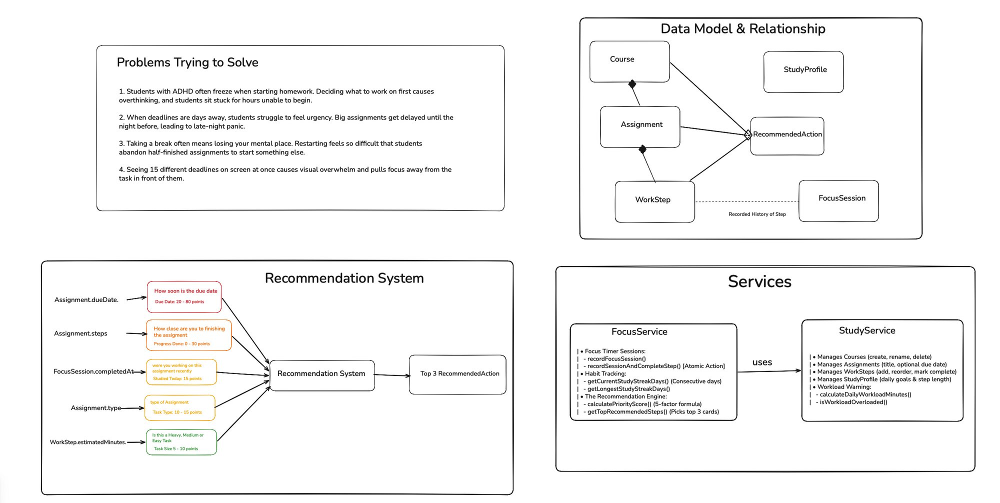

# ADHD Study Assistant

A mobile study manager built with Flutter and pure Dart to help students with ADHD overcome task paralysis, break big assignments into small steps, and build daily study habits.

---

## 1. Problems We Solve

1. **Task Paralysis**: Students with ADHD often freeze when starting homework. Deciding what to work on first causes overthinking, and students sit stuck for hours unable to begin.
2. **Deadline Procrastination**: When deadlines are days away, students struggle to feel urgency. Big assignments get delayed until the night before, leading to late-night panic.
3. **Losing Your Place**: Taking a break often means losing your mental place. Restarting feels so difficult that students abandon half-finished assignments to start something else.
4. **Visual Overwhelm**: Seeing 15 different deadlines on screen at once causes panic and pulls focus away from the task in front of them.

---

## 2. Architecture Overview



---

## 3. Data Models

* **Course**: A subject or class (e.g., Mobile Development, Algorithms). Holds a name and a color code.
* **Assignment**: A school task or project that belongs to a Course. Has an optional due date, a task type (exam, project, homework), and a list of steps.
* **WorkStep**: A small subtask inside an assignment (usually 20 to 30 minutes). Can be marked completed.
* **FocusSession**: A saved record of focused study time spent on a specific WorkStep.
* **StudyProfile**: User settings, such as daily study goals, daily workload limits, and timer length.
* **RecommendedAction**: A read-only card shown to the user. It combines the next unfinished WorkStep, its assignment title, course color, and a priority score.

---

## 4. Services

* **StudyService**:
  * Manages courses, assignments, and work steps (create, rename, reorder, delete).
  * Manages the user study profile.
  * Calculates daily workload in minutes and checks for workload overload.

* **FocusService**:
  * Records focus timer sessions.
  * Tracks study habits and daily streaks.
  * Runs the recommendation engine to pick the top 3 steps to work on.
  * Depends on `StudyService` to get courses and task data.

---

## 5. How the Recommendation Engine Works

Instead of showing a long list of deadlines, the app calculates a priority score (0 to 100+ points) for every unfinished step based on 5 factors:

1. **Due Date (20 – 80 points)**: Tasks due today or tomorrow get the highest urgency score.
2. **Progress Done (0 – 30 points)**: Tasks that are almost finished get extra points so students get the reward of completing them.
3. **Studied Today (15 points)**: If you worked on this task today, it gets a bonus to keep your momentum going.
4. **Task Type (10 – 15 points)**: Exams and big projects get higher priority than simple reading.
5. **Task Size (5 – 10 points)**: Heavier steps get a small boost so they are not pushed away forever.

**Output**: The top 3 highest-scoring steps are shown on the home screen as `RecommendedAction` cards so the student can start immediately without deciding.

---

## 6. How to Run

1. Get dependencies:
   ```bash
   flutter pub get
   ```

2. Run tests:
   ```bash
   flutter test
   ```

3. Run the app:
   ```bash
   flutter run
   ```
